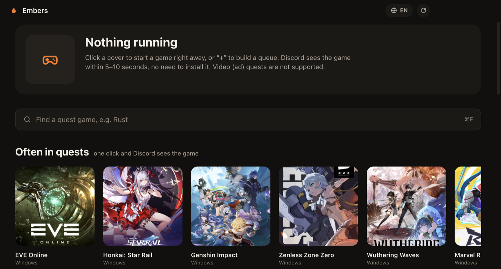
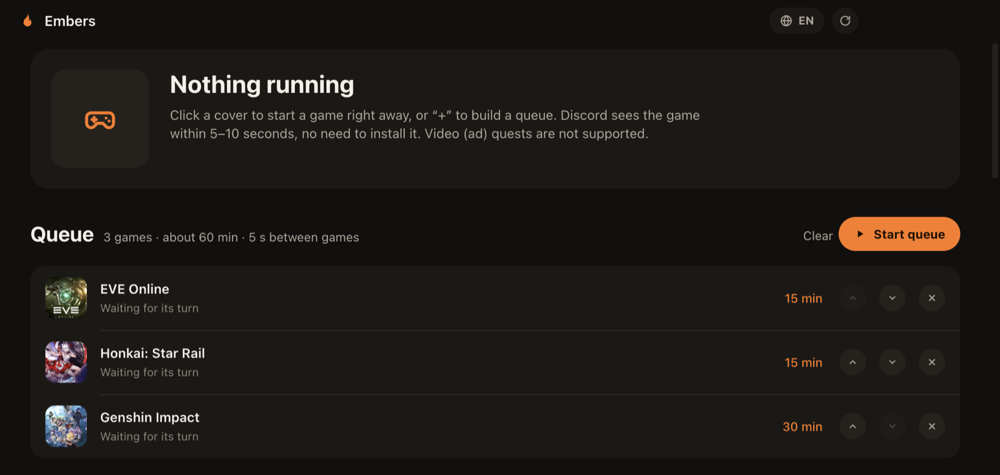
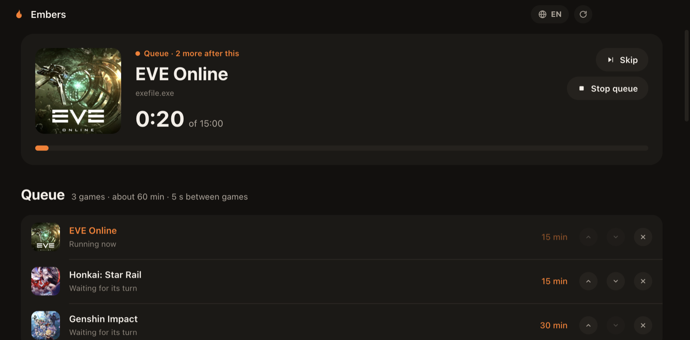

<p align="center">
  
</p>

<h1 align="center">Embers</h1>

<p align="center">
  Completes Discord <b>game quests</b> without installing the games.<br>
  Click a cover, and Discord thinks you are playing.
</p>

<p align="center">
  <a href="../../releases/latest"><b>Download for macOS or Windows</b></a>
  &nbsp;·&nbsp;
  <a href="README.ru.md">Русская версия</a>
</p>

<p align="center">
  
</p>

> **Video (ad) quests do not work.** Quests like "Watch a video, get 200 Orbs" can't be completed
> with Embers. It only handles quests that ask you to **play a game** for some minutes.

## What it is

Discord has quests like "play a game for 15 minutes and get a reward". Normally you have to
download the game and keep it running. Embers starts a tiny empty process that has the same file
name as the game instead. Discord sees it as a running game and counts the time. You don't download
anything, and your computer stays idle.

## Features

- **10,000+ games** from Discord's own database, with covers and search. The list updates itself
  once a day.
- **One-click start:** click a cover, and Discord sees the game in 5–10 seconds.
- **Queue:** add several games, set the time for each, and they run one after another.
- **Windows games work on a Mac too**, for example EVE Online, Honkai: Star Rail, Genshin Impact.
- **Runs in the background:** minimize the window and use your computer as usual.
- **English and Russian:** English by default, switch with the **EN / RU** button.
- **Cleans up after itself:** closing the app stops every "game", so no stale status stays in Discord.

## Download and install

Get the latest files from the [Releases page](../../releases/latest).

### macOS (13 or newer)

1. Download `Embers.dmg`, open it, and drag Embers into **Applications**.
2. **First launch:** right-click Embers → **Open** → **Open**. The app isn't signed with an Apple
   certificate yet, so a normal double-click is blocked. You only need to do this once.

### Windows (10 or 11, 64-bit)

1. Download `Embers-Windows-x64.zip` and extract it fully (for example to `C:\Embers`).
2. Open the `Embers` folder and run `Embers.exe`.
3. If you see "Windows protected your PC": click **More info → Run anyway**. The app isn't signed
   with a paid certificate yet, so SmartScreen warns about it. You only need to do this once.

The Windows build is new. If something doesn't work, please
[open an issue](../../issues) and say what you see.

Both versions need the **Discord desktop app** (the browser version doesn't detect games).

## How to use

### 1. Accept the quest in Discord

Open **Quests** in Discord and press **Accept quest**. Progress only counts for accepted quests.
Note the game from the quest, for example "Play **EVE Online** for 15 minutes".

Also check that **Settings → Activity Privacy → Share your activity** is on in Discord.

### 2. Start the game in Embers

Find the game with search (`Ctrl/⌘ + F`) or in the "Often in quests" row and **click its cover**.
A timer appears at the top, and Discord shows the game as running within 5–10 seconds.

You can minimize the window. Don't close it while a quest is running: closing stops every game.

### 3. Wait and claim the reward

When the quest time is over, open Discord and claim your reward in **Quests**.

## Queue

With several quests, there is no need to switch games by hand.

<p align="center">
  
</p>

1. Hover a cover and click **+** (macOS: right-click → *Add to queue* also works). Repeat for
   every game.
2. A **Queue** list appears. Pick the time for each game (5 minutes to 2 hours) and set the order
   with the arrows.
3. Click **Start queue**.

<p align="center">
  
</p>

The games run one by one: a game stays on for its time plus 45 seconds as a safety margin, then
there is a 5 second pause, then the next game starts. **Skip** jumps straight to the next game,
**Stop queue** ends it. The queue is saved if you close the app.

> If several games run at the same time, Discord counts progress for each of them, but shows
> only one in your profile.

## Tips

- Keep the computer awake for long quests: sleep stops everything (a turned-off screen is fine).
  On a Mac use Amphetamine or run `caffeinate -i` in Terminal. On Windows use PowerToys Awake or
  the power settings.
- Game not in the list? Press the refresh button in the top right corner. New quest games are
  added by Discord to the same public list the app uses.
- If Discord doesn't see the game, wait 10–15 seconds, then check that the desktop Discord app is
  open and "Share your activity" is on.

## How it works

Discord looks at the running applications and compares their file paths with its public game
database (`discord.com/api/v9/applications/detectable`). On macOS only applications that have a
window are counted.

Embers puts a tiny helper program at a path that ends exactly like the game's file in that
database, for example `…/games/starrail.exe`, and starts it. On macOS the helper
([`Embers/Helper/fakegame.m`](Embers/Helper/fakegame.m)) has an invisible 1×1 window; on Windows
([`Windows/helper/fakegame.go`](Windows/helper/fakegame.go)) it is an empty program that sleeps.
Discord finds the match and reports the quest progress by itself. The helper files are kept in
`~/Library/Application Support/Embers/fake/` (macOS) or `%APPDATA%\Embers\fake\` (Windows) and are
safe to delete while the app is closed.

## Build from source

**macOS:** Xcode 15+ and [XcodeGen](https://github.com/yonaskolb/XcodeGen).

```bash
cd Embers
./build.sh                    # Embers.app
./Installer/make-dmg.sh       # Embers.dmg with the install window
```

Or open `Embers/Embers.xcodeproj` in Xcode and press ⌘R.

**Windows:** Node.js 20+ and [Go](https://go.dev/dl/) 1.21+ (works on macOS, Linux and Windows).

```bash
cd Windows
npm install
npm run dev                   # run from source
npm run build                 # dist/Embers-Windows-x64.zip
```

## Disclaimer

This is an unofficial tool and is not affiliated with Discord. Using it may violate Discord's
Terms of Service, and your account could be warned or banned. You use it at your own risk.

Game names and covers belong to their owners. Embers doesn't store covers; they are loaded from
Discord's CDN while the app runs.

## License

[MIT](LICENSE)
