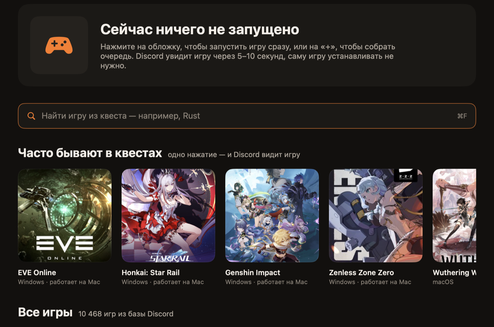
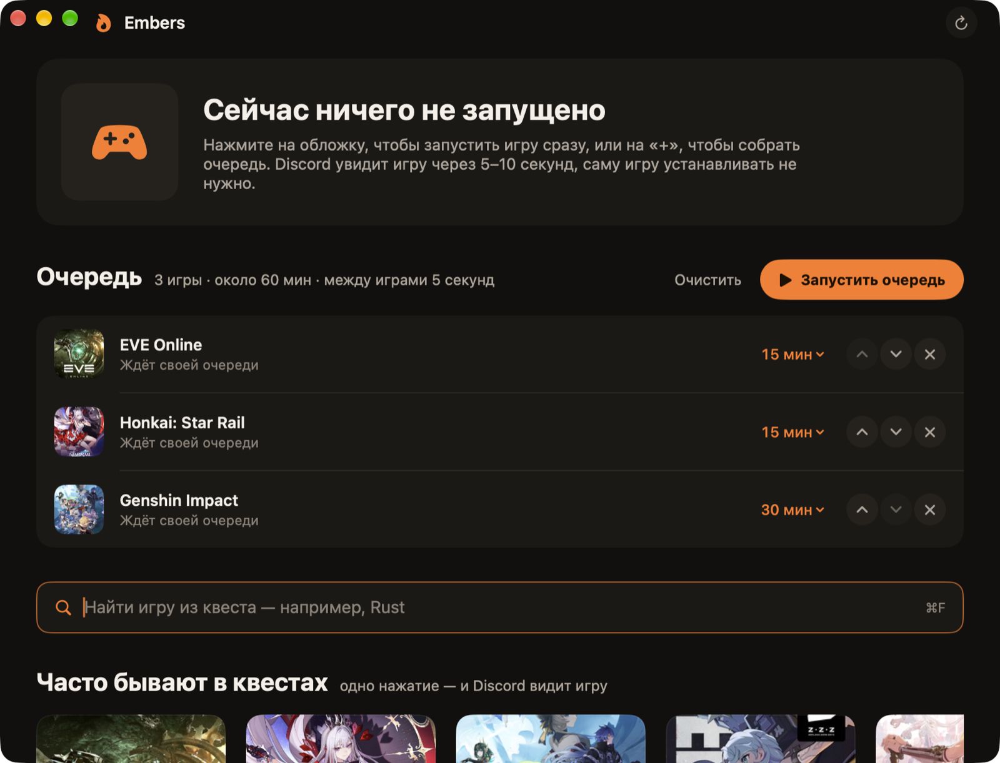
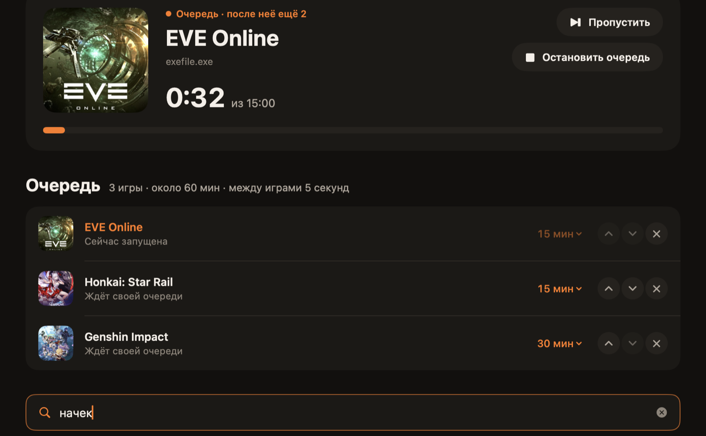

<p align="center">
  
</p>

<h1 align="center">Embers</h1>

<p align="center">
  Выполняет игровые квесты Discord без установки самих игр.<br>
  Нажали на обложку — Discord считает, что вы играете.
</p>

<p align="center">
  <a href="../../releases/latest"><b>Скачать для macOS</b></a>
</p>

<p align="center">
  
</p>

## Что это

В Discord есть квесты вида «поиграйте в игру 15 минут и получите награду». Чтобы их выполнить, обычно
нужно скачать игру и держать её запущенной. Embers запускает вместо игры маленький пустой процесс
с тем же именем файла. Discord видит его как запущенную игру и засчитывает время. Игру скачивать
не нужно, компьютер не нагружается.

## Что умеет

- **10 000+ игр** из базы Discord с обложками и поиском. База обновляется сама раз в сутки.
- **Запуск в один клик:** нажали на обложку, через 5–10 секунд Discord видит игру.
- **Очередь:** добавьте несколько игр, задайте каждой время, и они пойдут одна за другой.
- **Windows-игры тоже:** EVE Online, Honkai: Star Rail, Genshin Impact и другие работают на Mac.
- **Работает в фоне:** окно можно свернуть и спокойно пользоваться компьютером.
- **Аккуратно закрывается:** при выходе все «игры» останавливаются, статус в Discord не зависает.

## Установка

1. Скачайте `Embers.dmg` со страницы [Releases](../../releases/latest).
2. Откройте файл и перетащите Embers в папку «Программы».
3. **Первый запуск:** нажмите на Embers правой кнопкой → «Открыть» → «Открыть».
   Приложение пока не подписано сертификатом Apple, поэтому обычный двойной клик macOS заблокирует.
   Это нужно сделать только один раз.

Требуется macOS 13 или новее и десктопное приложение Discord (в браузере не работает).

## Как пользоваться

### 1. Примите квест в Discord

Откройте в Discord раздел «Задания» и нажмите «Принять задание» у нужных квестов. Прогресс
идёт только по принятым. Запомните название игры из условия: «Играйте в **EVE Online** 15 минут».

Также проверьте, что в Discord включено «Настройки → Конфиденциальность активности →
Публиковать активность».

### 2. Запустите игру в Embers

Найдите игру через поиск (⌘F) или в ряду «Часто бывают в квестах» и **нажмите на обложку**.
В верхней панели появится таймер. Через 5–10 секунд Discord покажет, что вы играете.

Окно Embers можно свернуть. Закрывать его крестиком нельзя, пока идёт квест: закрытие останавливает
все игры.

### 3. Дождитесь времени квеста

Когда пройдёт нужное время, откройте Discord и заберите награду в разделе «Задания».

## Очередь

Если квестов несколько, не нужно сидеть и переключать игры вручную.

<p align="center">
  
</p>

1. Наведите курсор на обложку и нажмите **«+»** (или правая кнопка → «Добавить в очередь»).
   Повторите для остальных игр.
2. Под панелью «Сейчас играет» появится список «Очередь». Для каждой игры выберите время:
   от 5 минут до 2 часов. Порядок меняется стрелками, лишнюю игру можно убрать крестиком.
3. Нажмите **«Запустить очередь»**.

<p align="center">
  
</p>

Дальше всё идёт само: игра работает заданное время и ещё 45 секунд про запас, затем пауза
5 секунд, и запускается следующая. Во время работы доступны кнопки **«Пропустить»**
(сразу к следующей игре) и **«Остановить очередь»**. Очередь сохраняется, если закрыть приложение.

> Если запущено несколько игр одновременно, Discord засчитывает прогресс по каждой из них.
> В профиле он показывает только одну.

## Советы

- Чтобы квест шёл ночью, не давайте компьютеру уходить в сон: сон останавливает всё, а вот
  выключенный экран не мешает. Подойдёт Amphetamine или команда `caffeinate -i` в Терминале.
- Не нашли игру в списке? Нажмите кнопку обновления в правом верхнем углу: Embers скачает
  свежую базу. Новые игры для квестов Discord добавляет в тот же список, по которому
  распознаёт игры сам.
- Если Discord не видит игру, подождите 10–15 секунд. Затем проверьте, что десктопный
  Discord открыт и «Публиковать активность» включена.

## Как это работает

Discord на macOS берёт список запущенных приложений и сравнивает путь к их файлу с публичной базой
игр (`discord.com/api/v9/applications/detectable`). Учитываются только приложения, у которых
есть окно.

Embers кладёт маленький helper ([`Embers/Helper/fakegame.m`](Embers/Helper/fakegame.m)) по пути,
который заканчивается так же, как файл игры в этой базе, например `…/games/starrail.exe`,
и запускает его с невидимым окном 1×1. Discord находит совпадение и сам начинает слать
прогресс по квесту. Файлы helper'а лежат в `~/Library/Application Support/Embers/fake/`,
их можно безопасно удалить, когда приложение закрыто.

## Сборка из исходников

Нужен Xcode 15+ и [XcodeGen](https://github.com/yonaskolb/XcodeGen).

```bash
cd Embers
./build.sh                    # Embers.app
./Installer/make-dmg.sh       # Embers.dmg с окном установки
```

Или откройте `Embers/Embers.xcodeproj` в Xcode и нажмите ⌘R.

## Важно

Это неофициальный инструмент, он не связан с Discord. Использование может нарушать
условия Discord: аккаунт могут предупредить или заблокировать. Вы отвечаете за свой аккаунт сами.

Названия и обложки игр принадлежат их владельцам. Embers не хранит их у себя, обложки
загружаются из CDN Discord во время работы.
