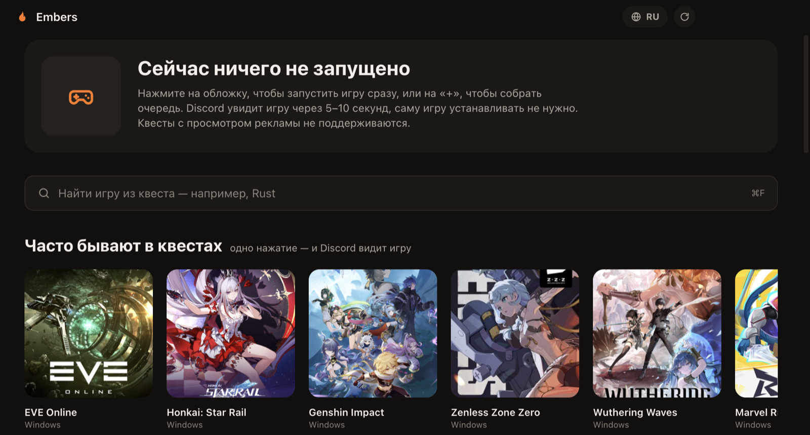
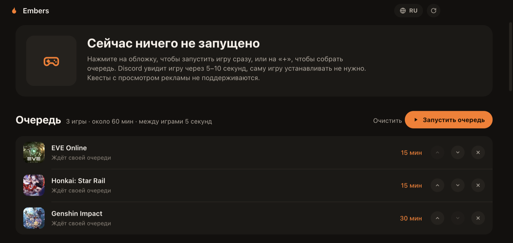
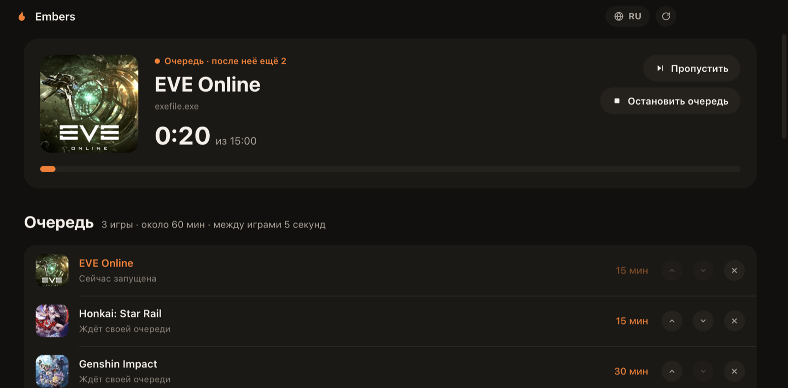

<p align="center">
  
</p>

<h1 align="center">Embers</h1>

<p align="center">
  Выполняет <b>игровые квесты</b> Discord без установки самих игр.<br>
  Нажали на обложку — Discord считает, что вы играете.
</p>

<p align="center">
  <a href="../../releases/latest"><b>Скачать для macOS и Windows</b></a>
  &nbsp;·&nbsp;
  <a href="README.md">English</a>
</p>

<p align="center">
  
</p>

> **Квесты с просмотром рекламы не работают.** Задания вроде «Посмотрите видео и получите
> 200 орбов» Embers выполнить не может. Он умеет только квесты, где нужно **играть в игру**
> несколько минут.

## Что это

В Discord есть квесты вида «поиграйте в игру 15 минут и получите награду». Обычно для этого нужно
скачать игру и держать её запущенной. Embers вместо игры запускает маленький пустой процесс
с тем же именем файла. Discord видит его как запущенную игру и засчитывает время. Ничего скачивать
не нужно, компьютер не нагружается.

## Что умеет

- **10 000+ игр** из базы самого Discord, с обложками и поиском. Список обновляется сам раз в сутки.
- **Запуск в один клик:** нажали на обложку, через 5–10 секунд Discord видит игру.
- **Очередь:** добавьте несколько игр, задайте каждой время, и они пойдут одна за другой.
- **Windows-игры работают и на Mac**, например EVE Online, Honkai: Star Rail, Genshin Impact.
- **Работает в фоне:** окно можно свернуть и спокойно пользоваться компьютером.
- **Английский и русский:** по умолчанию английский, переключается кнопкой **EN / RU**.
- **Аккуратно закрывается:** при выходе все «игры» останавливаются, статус в Discord не зависает.

## Скачивание и установка

Свежие файлы лежат на странице [Releases](../../releases/latest).

### macOS (13 и новее)

1. Скачайте `Embers.dmg`, откройте и перетащите Embers в **«Программы»**.
2. **Первый запуск:** нажмите на Embers правой кнопкой → **«Открыть»** → **«Открыть»**. Приложение
   пока не подписано сертификатом Apple, поэтому обычный двойной клик macOS заблокирует.
   Это нужно сделать только один раз.

### Windows (10 или 11, 64-бит)

1. Скачайте `Embers-Windows-x64.zip` и полностью распакуйте (например, в `C:\Embers`).
2. Откройте папку `Embers` и запустите `Embers.exe`.
3. Если появится «Windows защитила ваш компьютер»: нажмите **«Подробнее» → «Всё равно выполнить»**.
   Приложение пока не подписано платным сертификатом, поэтому SmartScreen предупреждает о нём.
   Это нужно сделать только один раз.

Версия для Windows новая. Если что-то не работает, [создайте issue](../../issues) и опишите,
что именно вы видите.

Для обеих версий нужно **десктопное приложение Discord** (в браузере игры не определяются).

## Как пользоваться

### 1. Примите квест в Discord

Откройте в Discord раздел **«Задания»** и нажмите **«Принять задание»**. Прогресс идёт только по
принятым квестам. Запомните игру из условия, например «Играйте в **EVE Online** 15 минут».

Также проверьте, что в Discord включено **«Настройки → Конфиденциальность активности →
Публиковать активность»**.

### 2. Запустите игру в Embers

Найдите игру через поиск (`Ctrl/⌘ + F`) или в ряду «Часто бывают в квестах» и **нажмите на обложку**.
Сверху появится таймер, а через 5–10 секунд Discord покажет, что игра запущена.

Окно можно свернуть. Не закрывайте его, пока идёт квест: закрытие останавливает все игры.

### 3. Дождитесь и заберите награду

Когда время квеста пройдёт, откройте Discord и заберите награду в разделе «Задания».

## Очередь

Если квестов несколько, переключать игры вручную не нужно.

<p align="center">
  
</p>

1. Наведите курсор на обложку и нажмите **«+»** (на macOS работает и правая кнопка →
   «Добавить в очередь»). Повторите для каждой игры.
2. Появится список **«Очередь»**. Выберите время для каждой игры (от 5 минут до 2 часов) и порядок
   стрелками.
3. Нажмите **«Запустить очередь»**.

<p align="center">
  
</p>

Игры идут по одной: игра работает своё время плюс 45 секунд про запас, затем пауза 5 секунд и
запускается следующая. **«Пропустить»** сразу переходит к следующей, **«Остановить очередь»**
завершает её. Очередь сохраняется, если закрыть приложение.

> Если запущено несколько игр одновременно, Discord засчитывает прогресс по каждой из них, но
> показывает в профиле только одну.

## Советы

- Для долгих квестов не давайте компьютеру уходить в сон: сон останавливает всё (выключенный
  экран не мешает). На Mac подойдёт Amphetamine или `caffeinate -i` в Терминале. На Windows —
  PowerToys Awake или настройки питания.
- Нет игры в списке? Нажмите кнопку обновления в правом верхнем углу. Новые игры для квестов
  Discord добавляет в тот же публичный список, который использует приложение.
- Если Discord не видит игру, подождите 10–15 секунд и проверьте, что десктопный Discord открыт
  и «Публиковать активность» включена.

## Как это работает

Discord смотрит на запущенные приложения и сравнивает пути к их файлам со своей публичной базой
игр (`discord.com/api/v9/applications/detectable`). На macOS учитываются только приложения,
у которых есть окно.

Embers кладёт маленькую программу-помощник по пути, который заканчивается так же, как файл игры
в этой базе, например `…/games/starrail.exe`, и запускает её. На macOS помощник
([`Embers/Helper/fakegame.m`](Embers/Helper/fakegame.m)) имеет невидимое окно 1×1, на Windows
([`Windows/helper/fakegame.go`](Windows/helper/fakegame.go)) это пустая программа, которая спит.
Discord находит совпадение и сам отправляет прогресс по квесту. Файлы помощника лежат в
`~/Library/Application Support/Embers/fake/` (macOS) или `%APPDATA%\Embers\fake\` (Windows),
их можно безопасно удалить, когда приложение закрыто.

## Сборка из исходников

**macOS:** Xcode 15+ и [XcodeGen](https://github.com/yonaskolb/XcodeGen).

```bash
cd Embers
./build.sh                    # Embers.app
./Installer/make-dmg.sh       # Embers.dmg с окном установки
```

Или откройте `Embers/Embers.xcodeproj` в Xcode и нажмите ⌘R.

**Windows:** Node.js 20+ и [Go](https://go.dev/dl/) 1.21+ (собирается на macOS, Linux и Windows).

```bash
cd Windows
npm install
npm run dev                   # запуск из исходников
npm run build                 # dist/Embers-Windows-x64.zip
```

## Важно

Это неофициальный инструмент, он не связан с Discord. Использование может нарушать условия
Discord: аккаунт могут предупредить или заблокировать. Вы используете его на свой риск.

Названия и обложки игр принадлежат их владельцам. Embers не хранит обложки, они загружаются
из CDN Discord во время работы.

## Лицензия

[MIT](LICENSE)
